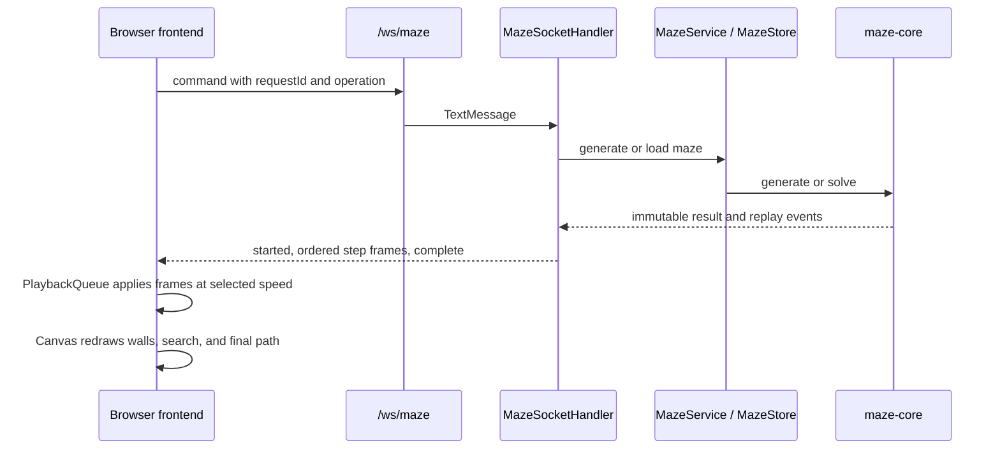

# MazeDecoder workflow

This document describes the implemented system at the public deployment, based on
the current source and its protocol contract. It is a maintained operational guide,
not a future design.

## Browser-to-server playback

`frontend/app.js` creates a unique request ID in `start()`, sends the command on
the shared WebSocket, and accepts only frames whose `requestId` matches the active
`PlaybackQueue`. `tick()` drains that queue at the user-selected step rate, which
keeps the network producer independent of the animation speed.

For `generate`, `MazeSocketHandler.generate()` emits one `WallRemoved` event for
each carve and finishes with a `GridView`. The browser applies each carve to its
closed local grid and saves the returned `mazeId`. For `solve`, the handler loads
that maze through `MazeService`, emits explored cells, then sends the solution
path and statistics. For `race`, `search()` computes each selected algorithm and
interleaves exploration frames round-robin; each frame retains its algorithm tag
so the browser renders the correct canvas panel.

## Connection recovery and failure handling

The browser constructs the socket URL from `window.MAZE_CONFIG.apiBase`. `connect()`
uses `wss:` for an HTTPS API, waits up to 25 seconds for opening, and retries with
an exponential delay capped at ten seconds. If a stream closes before its terminal
frame, `fail()` clears the partial playback and tells the user to retry. A fully
received stream may continue animating if an idle socket closes afterward.

The server admits one active command per connection. `MazeSocketHandler` limits
streaming work to four worker threads and a queue of sixteen tasks. It returns
structured `BUSY`, `SERVER_BUSY`, `INVALID_REQUEST`, and `MAZE_NOT_FOUND` errors;
on disconnect it cancels the associated task. `MazeStore` bounds retained mazes,
so an expired ID is deliberately recoverable by generating again with the same
seed.

## Local and public operations

Run the full Java verification with `cmd /c mvnw.cmd verify` from the repository
root. Run the frontend model tests with `npm.cmd test` from `frontend/`; build it
with `npm.cmd run build`. The frontend build receives the API address through
`MAZE_API_URL` and Vercel serves the generated static files. Render builds the
Docker image at the repository root and exposes the server health check at
`/api/health`.

The deployed frontend is [mazedecoder.vercel.app](https://mazedecoder.vercel.app/)
and the API health endpoint is
[mazedecoder-api.onrender.com/api/health](https://mazedecoder-api.onrender.com/api/health).

## Audit findings

The prior README described the project as limited to Phases 1–2 and said there was
no browser page. That was stale after the Phase 3 deployment. This README update
corrects that claim. No source/protocol mismatch was found in the reviewed
generation, solving, WebSocket, or browser playback paths.
